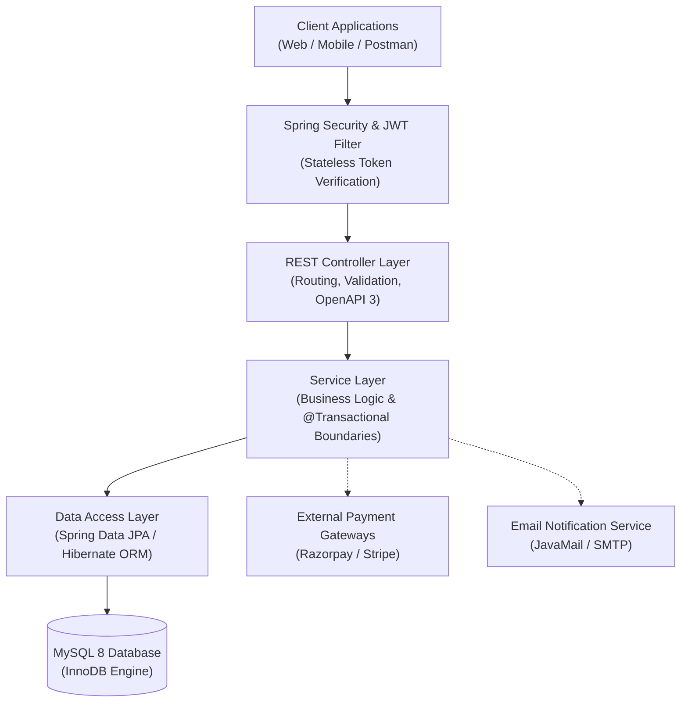

# Library Management System

A production-ready, modular RESTful backend service built with Spring Boot and MySQL for enterprise library management. The system manages cataloging, multi-tier circulation workflows (borrowing, returning, renewals), waitlist queueing, subscription memberships, automated fine calculation, online payment processing via Razorpay/Stripe, book reviews, and patron wishlists.

---

## Architecture Overview

The system follows a clean multi-tiered architecture designed for strict separation of concerns, high maintainability, and transactional data integrity:



### Architectural Principles
* **Stateless Authentication:** Spring Security intercepts incoming requests using a custom `JwtValidator` filter. Authentication state is validated from signed HMAC-SHA256 tokens without server-side session persistence.
* **Declarative Transaction Management:** Sensitive state mutations (book copy adjustments, checkouts, and fine settlements) execute within `@Transactional` boundaries, guaranteeing ACID compliance and preventing negative inventory allocations.
* **Separation of Models:** Domain entities are decoupled from client communication through Data Transfer Objects (DTOs) and dedicated mappers (`toDTO`), shielding internal schema representations.
* **Centralized Exception Handling:** A centralized `@RestControllerAdvice` (`GlobalExceptionHandler`) intercepts validation errors and domain exceptions, standardizing error envelopes into consistent API responses.

---

## Database Architecture & ERD

The persistence layer runs on MySQL 8 using the InnoDB storage engine to guarantee referential integrity through foreign key constraints, cascading rules, and unique composite indexes.

```mermaid
erDiagram
    USER ||--o{ BOOK_LOAN : borrows
    USER ||--o{ RESERVATION : places
    USER ||--o{ FINE : incurs
    USER ||--o{ PAYMENT : makes
    USER ||--o{ SUBSCRIPTION : holds
    USER ||--o{ BOOK_REVIEW : writes
    USER ||--o{ WISHLIST : maintains
    USER ||--o{ PASSWORD_RESET_TOKEN : requests

    GENRE ||--o{ GENRE : parent_of
    GENRE ||--o{ BOOK : classifies

    BOOK ||--o{ BOOK_LOAN : loaned_in
    BOOK ||--o{ RESERVATION : reserved_in
    BOOK ||--o{ BOOK_REVIEW : reviewed_in
    BOOK ||--o{ WISHLIST : saved_in

    BOOK_LOAN ||--o{ FINE : incurs
    BOOK_LOAN ||--o{ PAYMENT : settled_by
    FINE ||--o{ PAYMENT : settled_by

    SUBSCRIPTION_PLAN ||--o{ SUBSCRIPTION : defines
    SUBSCRIPTION ||--o{ PAYMENT : billed_by

    USER {
        bigint id PK
        varchar email UK
        varchar password
        varchar full_name
        varchar role
    }

    BOOK {
        bigint id PK
        varchar isbn UK
        varchar title
        varchar author
        bigint genre_id FK
        int total_copies
        int available_copies
        boolean active
    }

    GENRE {
        bigint id PK
        varchar name UK
        varchar code
        bigint parent_genre_id FK
        int display_order
    }

    BOOK_LOAN {
        bigint id PK
        bigint user_id FK
        bigint book_id FK
        varchar status
        date checkout_date
        date due_date
        date return_date
        int renewal_count
        boolean is_overdue
    }

    RESERVATION {
        bigint id PK
        bigint user_id FK
        bigint book_id FK
        varchar status
        int queue_position
        datetime reserved_at
        datetime available_until
    }

    FINE {
        bigint id PK
        bigint user_id FK
        bigint book_loan_id FK
        varchar fine_type
        varchar status
        bigint amount
    }

    PAYMENT {
        bigint id PK
        bigint user_id FK
        bigint book_loan_id FK
        bigint subscription_id FK
        bigint fine_id FK
        varchar payment_type
        varchar status
        bigint amount
        varchar transaction_id UK
    }

    SUBSCRIPTION_PLAN {
        bigint id PK
        varchar plan_code UK
        varchar plan_name
        int duration_days
        bigint price
        int maximum_books_allowed
        int max_days_per_book
    }

    SUBSCRIPTION {
        bigint id PK
        bigint user_id FK
        bigint plan_id FK
        date start_date
        date end_date
        boolean is_active
    }

    BOOK_REVIEW {
        bigint id PK
        bigint user_id FK
        bigint book_id FK
        int rating
        text review_text
    }

    WISHLIST {
        bigint id PK
        bigint user_id FK
        bigint book_id FK
        varchar notes
    }

    PASSWORD_RESET_TOKEN {
        bigint id PK
        bigint user_id FK
        varchar token UK
        datetime expiry_date
    }
```



### Core Domain Entities

| Entity | Description | Key Constraints |
| :--- | :--- | :--- |
| **`User`** | System accounts (Patrons and Administrators) | Unique `email` |
| **`Book`** | Catalog titles with real-time physical inventory counts | Unique `isbn`, `availableCopies <= totalCopies` |
| **`Genre`** | Hierarchical book classification categories | Self-referencing `parent_genre_id`, unique `name` |
| **`BookLoan`** | Circulation borrowing records, due dates, and renewal tracking | Foreign keys to `User` and `Book` |
| **`Reservation`** | FIFO queue holds for currently out-of-stock titles | Max hold limits, hold expiration timestamp |
| **`Fine`** | Overdue and book damage monetary penalties | Tracking paid, pending, and administratively waived states |
| **`Payment`** | Gateway transactions (Razorpay / Stripe) | Unique `transaction_id`, signature validation |
| **`SubscriptionPlan`** | Membership tiers defining loan caps and durations | Unique `plan_code` |
| **`Subscription`** | Active patron memberships mapped to a subscription plan | Active status and date-range validity checks |
| **`BookReview`** | Patron book ratings (1–5 stars) and critiques | Unique constraint on `(book_id, user_id)` (one review per user) |
| **`WishList`** | Patron reading wishlist and future hold planning | Unique constraint on `(user_id, book_id)` |
| **`PasswordResetToken`**| Time-limited cryptographic tokens for password recovery | Unique token with expiration date |

---

## Core Modules & Features

1. **Authentication & Authorization:** Secure signup, JWT authentication, password reset workflows, and role-based access (`ROLE_USER`, `ROLE_ADMIN`).
2. **Book Catalog & Inventory:** CRUD operations, bulk import capabilities, multi-attribute search (keyword, genre, availability), and inventory metrics.
3. **Circulation Management:** Borrowing validation against active membership quotas, check-in condition handling (returned, lost, damaged), and batch overdue status sweeps.
4. **Reservation Queuing:** Hold reservation queueing when books have zero available copies, with automatic assignment upon return.
5. **Subscription Plans:** Configurable membership tiers controlling maximum borrowed books and borrowing timeframes.
6. **Financials & Payments:** Fine assessment, administrative waiver tracking, and secure online payment settlement using Razorpay/Stripe checkout signatures.
7. **Social Engagement:** Book reviews with aggregate average rating computations and patron reading wishlists.

---

## API Documentation & Specification

* **Published Postman Collection:** [https://documenter.getpostman.com/view/40322305/2sBYHVwzFL](https://documenter.getpostman.com/view/40322305/2sBYHVwzFL)
* **Local Swagger UI:** `http://localhost:8080/swagger-ui/index.html`
* **Local OpenAPI Specification:** `http://localhost:8080/v3/api-docs`
* **Exported Postman Collection:** `Library_Management_System.postman_collection.json` (located in the repository root)

### Authentication Header
Protected endpoints require an RFC 6750 Bearer token:
```http
Authorization: Bearer <jwt_token>
```

---

## Tech Stack

* **Language:** Java 17
* **Framework:** Spring Boot 3+ (Spring Web, Spring Security, Spring Data JPA, Spring Validation)
* **Database:** MySQL 8
* **Persistence:** Hibernate ORM
* **Security:** JSON Web Tokens (JJWT 0.12.6) & BCrypt
* **Payment Gateways:** Razorpay Java SDK & Stripe
* **API Documentation:** SpringDoc OpenAPI 3 (`springdoc-openapi-starter-webmvc-ui`)
* **Testing:** JUnit 5, Mockito

---

## Getting Started

### Prerequisites
* Java Development Kit (JDK) 17+
* MySQL Server 8+
* Apache Maven (or use the included `./mvnw` wrapper)

### 1. Database Configuration
Create a MySQL database and update `Library-Management-System/src/main/resources/application.properties`:

```properties
spring.datasource.url=jdbc:mysql://localhost:3306/library_management?createDatabaseIfNotExist=true&useSSL=false
spring.datasource.username=root
spring.datasource.password=your_password
spring.jpa.hibernate.ddl-auto=update
spring.jpa.show-sql=false
```

### 2. Build the Application
Compile the project and run the automated test suite:

```bash
cd Library-Management-System
./mvnw clean test
```

### 3. Run the Application
Start the Spring Boot server:

```bash
./mvnw spring-boot:run
```

The application will start on `http://localhost:8080`. You can access the Swagger UI documentation at `http://localhost:8080/swagger-ui/index.html`.
